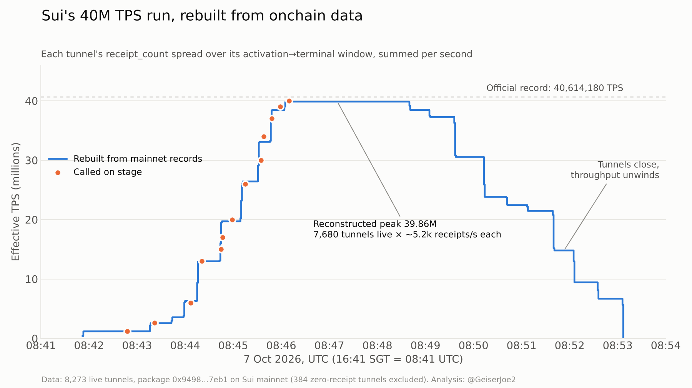

# sui-40m-tps-rebuild

Rebuilds Sui's 40,614,180 TPS record (Sui Basecamp, 7 Oct 2026) from public mainnet data. No wallet, no API key, no SDK. Just the settlement records the tunnels left onchain.

**Result:** the reconstructed peak is **39,862,531 TPS at 08:46:10 UTC**, 1.85% under the official figure. The curve steps through the numbers called on stage.



Write-up: _link to the article_

## Run it

```bash
./run.sh          # ~15-25 min, mostly GraphQL paging; writes data/ and out/
```

Or step by step:

```bash
python3 scripts/crawl_events.py data/events                                    # every event of the arena package
python3 scripts/fetch_records.py data/events/ArenaTunnelSettled.jsonl data/records.jsonl
python3 scripts/analyze.py data out                                            # live-run summary + per-second curve
python3 scripts/footprint.py data out/footprint.json                           # tx count, senders, gas, settlement lag
pip install matplotlib && python3 scripts/chart.py out/curve_live.csv out/tps_reconstructed.png
```

Python 3.10+, standard library only (matplotlib for the chart). Behind a TLS-intercepting proxy, set `SSL_CERT_FILE`.

## What it reads

| Object | ID |
| --- | --- |
| Arena-tunnel package (published 2 Oct 2026) | `0x9498606724aa4c03dd0e50ce508b3f5555c4915d3f8d0d4525c0f98dd1737eb1` |
| Tunnel registry | `0x11c05904ca67cea5658d5bc2a0a0171eafb5d1649bd4f3cd81392b2d11ea571d` |
| Test coin | `0xcb913929a95bc74d47c7d943730113bc19be32210374bc863729e4929b3eedcd::mtps::MTPS` (0 decimals) |
| Endpoint | `https://graphql.mainnet.sui.io/graphql` |

The IDs come from the production build config of the event explorer, https://tps.dopamint.fun/.

## Method

1. Crawl every `anchor::ArenaTunnel*` event (created, activated, settled, dispute opened, seat funded).
2. Read each `SettledOutcomeRecord`: `receipt_count`, `transcript_root`, final state, `terminal_timestamp`, `settled_at_ms`, `disposition`, `evidence_class`.
3. Define the live run as tunnels created between 08:30 and 09:30 UTC on 7 Oct 2026.
4. For each tunnel that produced receipts, spread `receipt_count` evenly from `activated_at_ms` to `terminal_timestamp`, then sum per second. Per-tunnel rates are nearly constant (median 5,231/s, p99 5,933/s), so the even-spread assumption costs little.

## Key numbers (live run)

| Metric | Value |
| --- | --- |
| Tunnels created / settled / ran | 10,376 / 8,657 / 7,680 |
| Offchain receipts committed | 15,241,348,297 |
| Peak reconstructed effective TPS | 39,862,531 (08:46:10 UTC) |
| Tunnels running at peak | 7,680 |
| Activation waves (running tunnels) | 256, 256, 256, 512, 1,280 ×4, 1,024, 256 |
| Mainnet txs carrying package events | 11,502 (net gas 85.74 SUI) |
| Cooperative-close lag (last update → onchain) | p50 0.43 s, p90 0.64 s |
| Idle tunnels force-closed after challenge window | 593 (526 after 3 h, 67 after 6 h) |
| Payment tunnels ending at their starting balances | 3,080 of 6,144 |

## Caveats

- 384 live tunnels report `receipt_count` 0 and a `terminal_timestamp` that is not a real time. They are excluded from the curve; their nonces total 260,358.
- `disposition` and `evidence_class` meanings are inferred from behaviour, not from published docs.
- The on-stage dots in the chart use a stream-clock offset pinned to the final "40 million" call (Day 1 livestream, YouTube `1e-cW4yBdMA`).

Data crawled 10 Oct 2026. If CertiK's report differs, the diff will be posted here.
